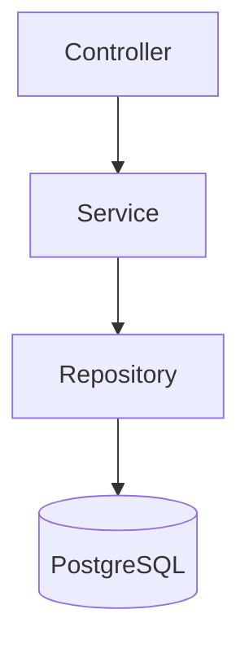

# Real-Time Chat

A real-time chat application built with **C++20 (Drogon)**, **PostgreSQL**, and (soon) **React + TypeScript**.

> **Status:** Phase 0 complete (project foundation). Auth, messaging and WebSocket are in progress.

## Architecture



Layered backend: controllers handle HTTP, services hold the logic, repositories talk to the database. All database access is asynchronous.

## Roadmap

- [x] Phase 0: Drogon + PostgreSQL setup, migrations, health endpoint
- [ ] Phase 1: Authentication (register, login, logout, sessions)
- [ ] Phase 2: Conversations and messages (REST)
- [ ] Phase 3: WebSocket (real-time messages, typing, online status)
- [ ] Phase 4: React frontend
- [ ] Phase 5: Security hardening, Docker, docs

## Quick start

**Requirements:** Linux, GCC 11+, CMake 3.20+, Docker Compose, Python 3.10+, [Drogon 1.9.11](https://github.com/drogonframework/drogon) (C++20, PostgreSQL enabled).

```bash
cp .env.example .env          # set a strong POSTGRES_PASSWORD
set -a; source .env; set +a
docker compose up -d --wait postgres

python3 -m venv .venv && source .venv/bin/activate
pip install -r requirements-dev.txt
python scripts/migrate.py

cmake -S backend -B build -DCMAKE_BUILD_TYPE=Debug
cmake --build build -j2
./build/chat_backend backend/config/config.json
```

Check it works:

```bash
curl -i http://127.0.0.1:8080/api/v1/health
# 200 {"database":"ok","status":"ok"}
```

## Tests

```bash
ctest --test-dir build --output-on-failure
python -m unittest discover -s backend/tests -p test_migrations.py -v
```

## Project structure

```
backend/    C++ Drogon API (controllers, services, repositories, migrations, tests)
frontend/   React + TypeScript (Phase 4)
scripts/    Migration runner
docs/       API contract and notes
```

## Security notes

- Secrets are read from environment variables and never committed.
- The health endpoint exposes only availability, no internal details.
- Authentication, authorization, rate limiting and security headers are planned in the next phases.

See [`docs/`](docs/) for more details.